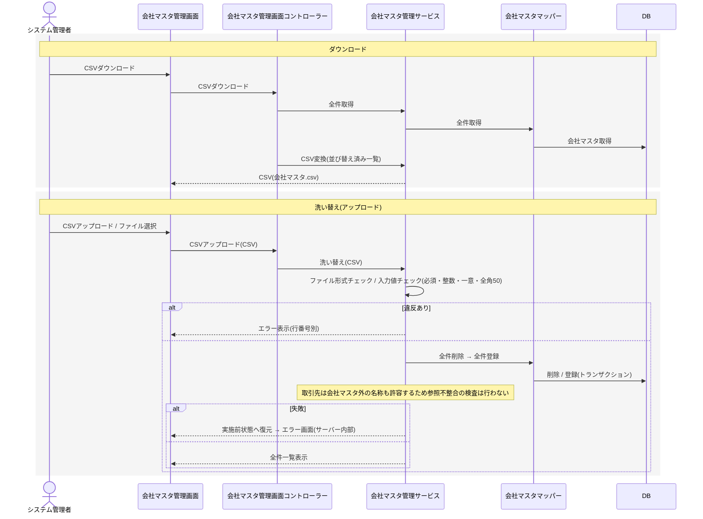

# シーケンス図 ― 会社マスタ管理（CSV洗い替え）

全件ダウンロードと、CSVアップロードによる洗い替え（全件削除→登録）。会社マスタは案件情報の取引先オートコンプリート候補として参照されるが、取引先は会社マスタ外の名称も許容されるため、洗い替えによる参照側の不整合は生じない。システム管理者のみ。

> 横断参照「会社名参照」（会社名一覧取得）は本グループに定義され、案件情報の一覧・登録・更新が取引先候補として利用する。会社マスタ管理サービスとは**別クラスとして併存**し、本機能の追加による変更は受けない。
> 会社マスタはレコードが0件になり得る（0件時のCSVはヘッダー行のみ、画面は「該当するデータがありません」を表示）。部署マスタのような0件化の除外条件は持たない。
